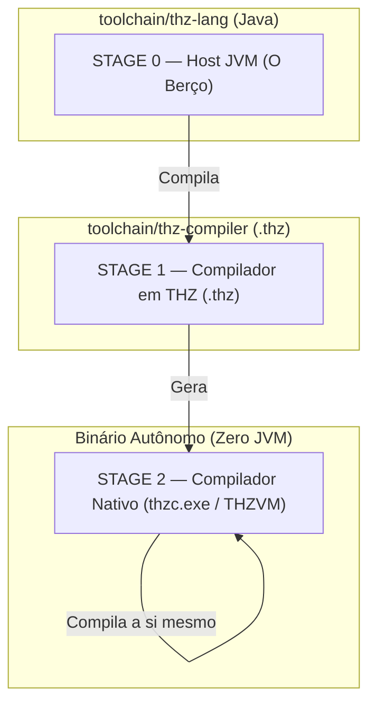

# Roadmap de Bootstrapping e Self-Hosting do THZ-LANG (Zero JVM)

> **Documento Arquitetural Oficial — Frente B.** Este documento estabelece o roteiro técnico, as etapas de compilação cruzada e o protocolo de validação para que a linguagem **THZ-LANG** atinja a auto-hospedagem plena (**Self-Hosting**), reescrevendo-se e compilando-se a si própria nos repositórios oficiais (`https://github.com/orgs/THZ-Lang/repositories`).

---

## 1. O que é Self-Hosting e Por que ele é o Marco Supremo de uma Linguagem

Uma linguagem de programação atinge o ápice de sua maturidade técnica quando o seu próprio compilador é escrito em sua própria sintaxe. Isso é denominado **Self-Hosting (Auto-Hospedagem)**:

1. **Prova de Expressividade:** Demonstra que a linguagem é completa o suficiente para descrever estruturas de dados complexas, grafos de árvores sintáticas (AST), análise léxica e geração de código de máquina.
2. **Independência Tecnológica (Soberania):** Elimina para sempre o vínculo com outras linguagens ou ambientes hospedeiros (Java, JVM, Python ou C++).
3. **Fechamento do Ciclo de Bootstrap:** A linguagem passa a evoluir a si mesma — novas palavras-chave e recursos são implementados diretamente em código `.thz`.

---

## 2. Precedentes Históricos: Como as Grandes Linguagens Fizeram

Nenhuma linguagem nasceu auto-hospedada no primeiro dia. Todas utilizaram um **"Berço Provisório" (Stage 0)**:

- **Rust:** Graydon Hoare escreveu o primeiro compilador (`rustboot`) em **OCaml**. Assim que o Rust foi capaz de compilar uma AST básica, reescreveram o `rustc` em Rust, compilaram usando o OCaml e **deletaram o OCaml do repositório**.
- **Go:** Ken Thompson e Rob Pike escreveram os primeiros compiladores (6g, 8g) em **C**. No Go 1.5, o compilador C foi totalmente traduzido para Go puro.
- **Java:** O primeiro compilador da Sun foi escrito em C; logo depois foi reescrito em Java puro (`javac`).
- **C# (.NET):** O compilador original era em C++ (`csc.exe`); o projeto **Roslyn** o reescreveu 100% em C#.

O **THZ-LANG** seguiu rigorosamente esse padrão da ciência da computação: utilizou o ecossistema JVM (`thz-core-jvm`) como seu berço inicial (Stage 0) e agora está pronto para a transição definitiva para o compilador self-hosted (`thz-compiler`).

---

## 3. Os Três Estágios do Bootstrap do THZ-LANG



| Estágio | Componente | Papel no Ecossistema | Status |
| :--- | :--- | :--- | :--- |
| **Stage 0** | `thz-core-jvm` / `thz-cli-jvm` | Compilador inicial hospedeiro (em Java). Responsável por ler os arquivos `.thz` do compilador e emitir o primeiro executável. | ✅ Concluído e operacional |
| **Stage 1** | `thz-compiler` (`*.thz`) | O compilador escrito na sintaxe oficial do THZ-LANG. Contém o vocabulário, parser e emissor de código. | 🔄 Em refinamento ativo |
| **Stage 2** | `thzc.exe` (Binário Nativo) | O compilador executável nativo standalone. Não depende de Java, JVM ou runtime externo. Compila código `.thz` diretamente. | 🎯 Alvo Final do Marco |

---

## 4. Anatomia do Compilador Self-Hosted (`toolchain/thz-compiler`)

O repositório `thz-compiler` é composto por 6 módulos em sintaxe pura `.thz`:

1. **`tokens.thz` (Vocabulário Léxico):**
   - Declara o enum `TokenTipo` com as 32 variantes da linguagem (`PALAVRA_CHAVE_PROGRAMA`, `REGRA_NEGOCIO`, `EXIGE`, `GARANTE`, `VARIAVEL`, etc.).
   - Define a estrutura `Token` (`tipo`, `valor`, `linha`, `coluna`) com a regra `CriarToken` e contratos de rastreabilidade (`EXIGE linha > 0, coluna > 0`).
2. **`ast.thz` (Modelo da Árvore Sintática):**
   - Define as estruturas `NoAST`, `MetadadosAST`, `CampoEstruturaAST`, `DeclEstruturaAST` e `ComandoAST`.
   - Fábrica de nós `FabricaNoAST` com rastreamento formal de linha e coluna.
3. **`lexer.thz` (Tokenizador em Português):**
   - Gerencia a máquina de estados `EstadoLexer` e classifica palavras-chave e operadores compostos (`<-`, `==`, `>=`, `<=`).
4. **`parser.thz` (Analisador Sintático e Validação de Blocos):**
   - Constrói a AST a partir da sequência de tokens e valida a abertura/fechamento de blocos declarativos (`PROGRAMA`, `ESTRUTURA`, `REGRA_NEGOCIO`, `TELA`).
5. **`codegen.thz` (Emissor de Código / C-ABI / LLVM IR):**
   - Emite instruções de máquina e declarações do runtime nativo (`thz_arena_alloc`, `thz_arena_free_all`, `define @main`).
6. **`driver.thz` (Orquestrador do Compilador):**
   - Ponto de entrada do compilador (`CompiladorThzSelfHost`). Orquestra o ciclo completo: Lexer (1/3) → Parser (2/3) → Codegen (3/3).

---

## 5. O Protocolo do Teste de Fogo (Identidade de Hash)

Para homologar oficialmente o Marco de Self-Hosting perante a comunidade e para fins de auditoria, executa-se o teste canônico de bootstrap:

```
Passo 1: Stage 0 (Java) compila thz-compiler/driver.thz ──────▶ Gera thzc_v1.exe
Passo 2: thzc_v1.exe compila thz-compiler/driver.thz  ──────▶ Gera thzc_v2.exe
Passo 3: thzc_v2.exe compila thz-compiler/driver.thz  ──────▶ Gera thzc_v3.exe

Critério de Sucesso Matemático:
SHA256(thzc_v2.exe) == SHA256(thzc_v3.exe)
```

Quando o hash do binário gerado pelo compilador nativo for **estritamente idêntico** ao hash gerado na iteração seguinte, o ciclo de reprodução está matematicamente selado.

A partir desse instante:
- A dependência de Java é desligada do repositório.
- O executável `thzc.exe` passa a ser distribuído como o compilador oficial soberano do **THZ-LANG**.
