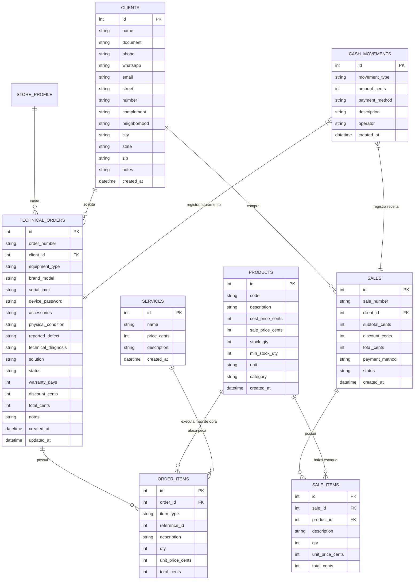

# Especificação Técnica de Arquitetura: PDV Universal & Gestão de Assistência Técnica

> **Projeto:** THZ ThermalKit (Desktop Tauri v2 + Rust + SQLite WAL + ESC/POS)  
> **Referência Arquitetural:** ADR-004 e modelo conceitual MapOS  
> **Data:** 20/10/2026  

---

## 1. Visão Geral

Este documento especifica a engenharia de software, modelagem relacional e fluxos operacionais para transformar o **THZ ThermalKit** em uma solução completa de:
1. **PDV de Balcão Universal:** Operável por qualquer estabelecimento comercial (vendas de itens, recebimento, controle de troco, catálogo de produtos com estoque e relatórios de caixa).
2. **Módulo Especializado de Assistência Técnica (MapOS inspired):** Gestão integral do ciclo de vida de reparos em computadores, notebooks, smartphones e tablets, com impressão térmica direta de 58 mm e 80 mm (driverless ESC/POS).

---

## 2. Modelo de Dados Relacional (SQLite WAL em `db.rs`)

Todas as tabelas contam com chaves primárias, controle de datas (`created_at`, `updated_at`), integridade referencial com `PRAGMA foreign_keys = ON;` e modo `WAL`.



---

## 3. Estados e Ciclo de Vida da Ordem de Serviço (O.S.)

Inspirado nas melhores práticas do MapOS, cada O.S. transita pelos seguintes estados bem definidos:

| Estado | Descrição | Impacto no Estoque / Caixa | Ação de Impressão (58mm/80mm) |
| :--- | :--- | :--- | :--- |
| **`ORCAMENTO`** | Entrada inicial do equipamento; aguarda avaliação técnica. | Nenhuma movimentação financeira. | 🖨️ **Comprovante de Entrada** (Via Cliente + Canhoto de Bancada) |
| **`AGUARDANDO_APROVACAO`** | Diagnóstico técnico e orçamento de peças/mão de obra finalizado. | Nenhuma movimentação. | 📲 Resumo enviado ao cliente (ou impresso para assinatura prévia). |
| **`APROVADO`** | Cliente aprovou a execução dos serviços e valores. | Reserva de peças no estoque. | — |
| **`EM_MANUTENCAO`** | Equipamento está na bancada com o técnico executando os serviços. | — | — |
| **`AGUARDANDO_PECAS`** | Manutenção pausada por falta de insumos/peças sobressalentes. | Alerta no painel de compras. | — |
| **`PRONTO`** | Manutenção concluída e testada; equipamento disponível para retirada. | — | Notificação automática (WhatsApp / Telefone). |
| **`FATURADO_ENTREGUE`** | Cliente retirou o equipamento, pagou e recebeu comprovante e termo. | Baixa definitiva de estoque e entrada no Caixa. | 🖨️ **Comprovante de Saída + Termo de Garantia** (Via Cliente). |
| **`CANCELADO`** | Reprovado pelo cliente ou aparelho sem reparo técnico viável. | Liberação de eventuais reservas de peças. | 🖨️ Comprovante de Devolução sem Custo. |

---

## 4. Layouts Térmicos Especializados para Bobinas de 58 mm (32 colunas)

### A. Comprovante de Entrada de O.S. (Via Cliente + Canhoto Equipamento)
```text
================================
         THZ INFOCELL           
 CNPJ: 16.843.110/0001-71       
 TEL: (21) 96565-0907           
================================
  COMPROVANTE DE ENTRADA O.S.   
         Nº OS: #1042           
 DATA: 20/10/2026  HORA: 20:45  
--------------------------------
CLIENTE: LUCAS THOMAZ           
TEL/ZAP: (21) 98888-7777        
--------------------------------
EQUIPAMENTO: SMARTPHONE         
MARCA/MOD.: SAMSUNG GALAXY S22  
SERIAL/IMEI: 354890123456789    
SENHA DISP.: [123456]           
ESTADO: TELA TRINCADA, MARCAS   
ACESSORIOS: CAPINHA, SEM CARREG 
--------------------------------
DEFEITO RELATADO:               
Aparelho nao carrega e esquenta 
na regiao do conector.          
--------------------------------
STATUS INICIAL: ORCAMENTO       
PRAZO PREVISTO: 24 A 48 HORAS   
--------------------------------
IMPORTANTE: Aparelhos nao       
retirados em 90 dias serao      
descartados conforme Art. do CDC
================================
(Destaque aqui para colar no aparelho)
- - - - - - - - - - - - - - - - 
       CANHOTO DE BANCADA       
O.S.: #1042 | DATA: 20/10/2026  
CLI: LUCAS THOMAZ               
EQ: SAMSUNG GALAXY S22          
DEF: Nao carrega / esquenta     
SENHA: [ 123456 ]               
- - - - - - - - - - - - - - - - 
```

### B. Comprovante de Saída & Termo de Garantia (Via Final)
```text
================================
         THZ INFOCELL           
  RUA CAMINHO EXISTENTE, 160    
 PALHADA | NOVA IGUACU - RJ     
 TEL/WHATSAPP: (21) 96565-0907  
================================
   ORDEM DE SERVICO FINALIZADA  
           Nº #1042             
 SAIDA: 22/10/2026  15:30:10    
--------------------------------
CLIENTE: LUCAS THOMAZ           
DOC: 123.456.789-00             
EQUIPAMENTO: SAMSUNG GALAXY S22 
--------------------------------
LAUDO TECNICO:                  
Substituicao da subplaca de     
carga oxidada e flex principal. 
--------------------------------
DETALHAMENTO DE ITENS:          
QTD  DESCRICAO        VALOR(R$) 
 1   SUBPLACA CARGA       90,00 
 1   FLEX INTERCONEXAO    45,00 
 1   MAO DE OBRA TEC     120,00 
--------------------------------
SUBTOTAL:              R$ 255,00
DESCONTO:               R$ 15,00
TOTAL A PAGAR:         R$ 240,00
--------------------------------
FORMA PAGAMENTO: PIX            
STATUS: PAGO E RETIRADO         
--------------------------------
      TERMO DE GARANTIA         
Garantia legal de 90 dias sobre 
as pecas e servicos descritos,  
balcao, mediante este documento.
Excluem-se quedas, umidade ou   
intervencao de terceiros.       
--------------------------------
Assinatura do Cliente:          


________________________________
LUCAS THOMAZ
================================
```

---

## 5. Módulo de Configurações Master

A tela de configurações centralizará:
- **Aba Estabelecimento:** Nome Fantasia, Razão Social, CNPJ/CPF, Telefone, WhatsApp, E-mail, Endereço com CEP.
- **Aba Pagamentos & PIX:** Tipo da Chave, Chave PIX, Nome do Titular e Cidade (para renderização de QRCode direto na bobina).
- **Aba Assistência Técnica:** Prazo padrão de garantia, Termo de Garantia resumido para cupom térmico, Cláusula de abandono de equipamentos, Checklist padrão.
- **Aba Hardware & Impressão:** Seletor de largura 58 mm / 80 mm, porta de comunicação (USB direto ou Bluetooth SPP), número de feeds de avanço final e Code Page CP860.

---

## 6. Roteiro de Entregas (Milestones)

1. **Milestone 1 — Banco de Dados & Configurações:** Atualização do DDL em `db.rs` e tela de configurações expandida.
2. **Milestone 2 — Cadastros Base:** Telas e comandos IPC de Clientes, Produtos/Peças (com estoque) e Serviços.
3. **Milestone 3 — Motor de Assistência Técnica (O.S.):** Ciclo completo de O.S. (Abertura, Triagem, Orçamento, Peças/Serviços, Mudança de Status e Impressão Térmica de Entrada e Saída).
4. **Milestone 4 — PDV Universal:** Caixa rápido com itens avulsos, pagamentos, troco e fechamento de caixa.
